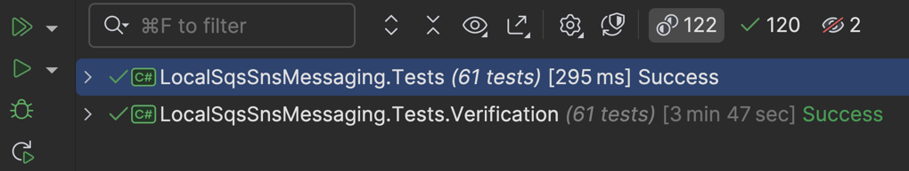

# InMemoryAws

[](https://www.nuget.org/packages/InMemoryAws "Download InMemoryAws from NuGet")
[](https://github.com/justeattakeaway/InMemoryAws/actions/workflows/build.yml)

## Overview

This .NET library is intended to provide a simple in-memory drop-in replacement for the AWS SDK for SQS, SNS, EventBridge, DynamoDB and S3, primarily for testing (but can be used for local development too).

It comes in two flavours that share the same in-memory cloud (`InMemoryAwsCloud`):

- **In-process** (`InMemoryAws` on NuGet) – hand the real AWS SDK clients an in-memory `HttpMessageHandler`, no network involved. This is the fastest option and the one to reach for in tests. It works with AWS SDK v4 and v3 (`3.7.x`), and depends on neither: you bring the SDK packages you use (see [Getting started](#getting-started)).
- **Standalone server** – a small native binary / container that speaks the AWS wire protocols over HTTP, with a dashboard, for local development or non-.NET consumers. See [Standalone server](#standalone-server).

> [!NOTE]
> **Coming from `LocalSqsSnsMessaging`?** The library was renamed `InMemoryAws` at v2.0.0, once it covered more than SQS and SNS. To move over:
>
> - Replace the `LocalSqsSnsMessaging` package with `InMemoryAws`. `LocalSqsSnsMessaging.AWSSDKv3` has no successor: `InMemoryAws` works with AWS SDK v3 and v4.
> - `InMemoryAws` no longer brings the AWS SDK with it: reference the `AWSSDK.*` packages your tests use, if your project doesn't already (see [Getting started](#getting-started)).
> - Change `using LocalSqsSnsMessaging;` to `using InMemoryAws;` (and the same for the sub-namespaces).
> - Rename `InMemoryAwsBus` to `InMemoryAwsCloud`. Its members are unchanged; only parameters that were named `bus` are now named `cloud`.
> - `InMemoryAwsHttpClientFactory` is now `InMemoryAwsSdkHttpClientFactory`, and `CreateAwsHttpClientFactory()` is `CreateAwsSdkHttpClientFactory()`, to make clear they are the AWS SDK's `Amazon.Runtime.HttpClientFactory`, not .NET's `IHttpClientFactory`. Like the `Create...Client()` methods, they are compiled into your project, so they are `internal` to it.
> - The server's container image is now `ghcr.io/justeattakeaway/inmemory-aws`, and its release binaries are named `inmemory-aws-<rid>`.

### What's emulated

| Service | Supported |
| --- | --- |
| **SQS** | Standard and FIFO queues, long polling, visibility timeouts, delays, message attributes, batch operations, redrive policies and dead-letter queues, message move tasks (redrive from a DLQ), fair queues (per-message-group deduplication), queue tags. |
| **SNS** | Topics (standard and FIFO), `sqs` and `http`/`https` subscriptions (and `email`/`email-json`, which stay pending confirmation), raw message delivery, [filter policies](#sns-filter-policies) on message attributes or the message body, [HTTP/S delivery](#sns-httphttps-subscriptions) with the confirmation handshake, retries and delivery policies, [subscription dead-letter queues](#sns-subscription-dead-letter-queues), topic attributes, permissions (explicit denies in topic policies are enforced) and tags. Mobile push platform applications and endpoints, and SMS settings, opt-outs and the SMS sandbox, are kept and answered for, but nothing is sent to a device or phone. |
| **EventBridge** | Event buses, rules with [event patterns](https://docs.aws.amazon.com/eventbridge/latest/userguide/eb-event-patterns.html), `PutEvents` routing to SQS (standard and FIFO), SNS and event bus targets, input transformers, target dead-letter queues, scheduled rules, archives and replays, connections and API destinations (HTTP calls through the cloud's `HttpClient`, with auth, rate limits and retries), global endpoints (replication without health-check failover), tags, `TestEventPattern`. See [EventBridge](#eventbridge). |
| **DynamoDB** | Tables with global and local secondary indexes, item reads and writes, condition, update, projection, filter and key-condition expressions (and the legacy `Expected`/`QueryFilter`/`AttributeUpdates` parameters), Query and Scan (paging, parallel scan), batches, transactions with idempotency tokens, PartiQL, DynamoDB Streams, time to live, on-demand backups and restores (including point in time), tags, resource policies, consumed capacity, vector indexes and `SearchVectors`. See [DynamoDB](#dynamodb). |
| **S3** | Buckets (general purpose and directory buckets), objects with metadata, ranges, conditional reads and writes, multipart uploads, copies, renames and appends, flexible checksums (CRC32, CRC32C, CRC64NVME, SHA-1, SHA-256), versioning and delete markers, listing (v1, v2, versions, uploads), tagging, Object Lock, ACLs and Object Ownership, bucket policies (explicit denies enforced) and Block Public Access, presigned URLs and POST uploads, CORS, website hosting, lifecycle, replication, default encryption and SSE-C, storage classes and restores, event notifications to SQS, SNS and EventBridge, S3 Metadata configurations, object annotations, and the bucket configurations S3 only stores (metrics, analytics, inventory, Intelligent-Tiering, logging, acceleration, request payment, ABAC). See [S3](#s3). |

SNS data protection policies, and subscriptions over other protocols (`sms`, `application`, `lambda`, `firehose`), throw `NotSupportedException`. DynamoDB operations for features of other services (S3 exports and imports, Kinesis destinations, auto scaling) answer `UnknownOperationException`. S3's `SelectObjectContent`, `WriteGetObjectResponse` (Object Lambda), `UpdateObjectEncryption` (KMS keys) and the deprecated metadata-table operations answer `NotImplemented`.

## Why?

Why would you build this when LocalStack already exists, and is awesome?

One word: _Speed_ 🏎️️⚡⚡

While LocalStack is relatively quick, nothing is a replacement for in-memory operations, it means you can run your tests faster, and you can run them in parallel without worrying about port conflicts.

Don't take our word for it, here are our tests for this project at the time of writing, ran against this library and LocalStack (to verify correctness):


> [!TIP]
> The LocalStack tests above were ran with the default behaviour of xUnit, which is to not run tests in parallel when a test collection is used.
> You can speed up this sort of test suite by fighting against xUnit's defaults (see [Meziantou.Xunit.ParallelTestFramework](https://github.com/meziantou/Meziantou.Xunit.ParallelTestFramework) for example) and getting tests to run in parallel.
> LocalStack has feature where if you pass an access key that looks like an account id, it will use this account for any resources created, this can help isolate tests from each other allowing them to run in parallel.

Additionally, some tests rely on the passage of time, but now with .NET's [`TimeProvider`](https://learn.microsoft.com/dotnet/api/system.timeprovider) you can control time in your tests, and travel through time like it's 1985, Great Scott!

## Getting started

Add the package, and the AWS SDK packages your code uses (any version from `3.7` on):

```bash
dotnet add package InMemoryAws
dotnet add package AWSSDK.SQS
```

`InMemoryAws` depends on no AWS SDK package. Instead, it adds a few small C# files to your project's compilation, one for each AWS SDK package the project references, so they compile against the SDK you have:

| Your project references | You get, on `InMemoryAwsCloud` |
| --- | --- |
| `AWSSDK.Core` (any of the below), on .NET or .NET Standard | `CreateAwsSdkHttpClientFactory()` and the `InMemoryAwsSdkHttpClientFactory` class (see [Integrating with an existing `HttpClientFactory`](#integrating-with-an-existing-httpclientfactory)) |
| `AWSSDK.SQS` | `CreateSqsClient()` |
| `AWSSDK.SimpleNotificationService` | `CreateSnsClient()` |
| `AWSSDK.EventBridge` | `CreateEventBridgeClient()` |
| `AWSSDK.DynamoDBv2` | `CreateDynamoDbClient()`, and on AWS SDK v3 `CreateDynamoDbStreamsClient()` |
| `AWSSDK.DynamoDBStreams` (AWS SDK v4) | `CreateDynamoDbStreamsClient()` |
| `AWSSDK.S3` | `CreateS3Client()` |

The files are added by the package's MSBuild targets (`build/InMemoryAws.targets`), whichever way the SDK is referenced: directly, transitively, through `packages.config` or as a plain assembly reference. They need C# 7.3 or later, and are `internal` to your project. Your IDE sees them like any other file; they aren't copied into your source tree.

Set `InMemoryAwsSdkSources` to `false` in a project to leave them out:

```xml
<PropertyGroup>
  <InMemoryAwsSdkSources>false</InMemoryAwsSdkSources>
</PropertyGroup>
```

You need this when two projects that both reference `InMemoryAws` share internals (one has `InternalsVisibleTo` the other), so the two copies of `CreateSqsClient()` don't clash: opt one of them out.

> [!NOTE]
> **.NET Framework** works too (tested on 4.8), with AWS SDK v3 or v4. The AWS SDK sends requests with `HttpWebRequest` there, not `HttpClient`, so it has no `HttpClientFactory`; instead each client `Create...Client()` makes has the HTTP handler in its request pipeline replaced with one that sends to the cloud. `CreateAwsSdkHttpClientFactory()`, which needs the SDK's `HttpClientFactory`, isn't available on .NET Framework.

### Without the build integration

A project that opts out, or that the build integration can't serve (VB, F#), can wire a client up with the same few lines the package adds, shown here in C#. The pieces they need ship in the library itself, with no AWS SDK dependency: `InMemoryAwsHttpMessageHandler` speaks one service's protocol, and `AwsServiceEndpoints` maps between the services and the names and URLs the AWS SDK uses for them.

```csharp
using Amazon.Runtime;
using Amazon.SQS;
using InMemoryAws;
using InMemoryAws.Http;

var cloud = new InMemoryAwsCloud();
using var sqs = new AmazonSQSClient(new AnonymousAWSCredentials(), new AmazonSQSConfig
{
    ServiceURL = AwsServiceEndpoints.GetServiceUrl(cloud, AwsServiceType.Sqs).AbsoluteUri,
    HttpClientFactory = new InMemoryAwsHttpClientFactory(cloud),
});

sealed class InMemoryAwsHttpClientFactory(InMemoryAwsCloud cloud) : HttpClientFactory
{
    public override HttpClient CreateHttpClient(IClientConfig config) =>
        AwsServiceEndpoints.TryGetServiceType(config.RegionEndpointServiceName, out var service)
            ? new HttpClient(new InMemoryAwsHttpMessageHandler(cloud, service))
            : throw new NotSupportedException($"InMemoryAws doesn't serve {config.RegionEndpointServiceName}.");
}
```

The package's own versions, under `build/sources/` in the package, add a fallback for other services and reuse one handler per service.

## Examples

### Basic Usage

Creating a topic, a queue, subscribing the queue to the topic, and sending a message to the topic, then receiving the message from the queue.

```csharp
using Amazon.SimpleNotificationService.Model;
using InMemoryAws;

var aws = new InMemoryAwsCloud();
using var sqs = aws.CreateSqsClient();
using var sns = aws.CreateSnsClient();

// Create a queue and a topic
var queueUrl = (await sqs.CreateQueueAsync("test-queue")).QueueUrl;
var topicArn = (await sns.CreateTopicAsync("test-topic")).TopicArn;
var queueArn = (await sqs.GetQueueAttributesAsync(queueUrl, ["QueueArn"])).Attributes["QueueArn"];

// Subscribe the queue to the topic
await sns.SubscribeAsync(new SubscribeRequest(topicArn, "sqs", queueArn)
{
    Attributes = new() { ["RawMessageDelivery"] = "true" }
});

// Send a message to the topic
await sns.PublishAsync(topicArn, "Hello, World!");

// Receive the message from the queue
var receiveMessageResponse = await sqs.ReceiveMessageAsync(queueUrl);
var message = receiveMessageResponse.Messages.Single();

Console.WriteLine(message.Body); // Hello, World!
```

### Time Travel

Creating a queue, sending a message to the queue with a delay, advancing time, and receiving the message from the queue.

```csharp
using Amazon.SQS.Model;
using InMemoryAws;
using Microsoft.Extensions.Time.Testing;

var timeProvider = new FakeTimeProvider(); // From `Microsoft.Extensions.TimeProvider.Testing` package

var aws = new InMemoryAwsCloud { TimeProvider = timeProvider};
using var sqs = aws.CreateSqsClient();
using var sns = aws.CreateSnsClient();

// Create a queue
var queueUrl = (await sqs.CreateQueueAsync("test-queue")).QueueUrl;

// Send a message to the topic
await sqs.SendMessageAsync(new SendMessageRequest(queueUrl, "Hello, World!")
{
    DelaySeconds = 30
});

// Receive the message from the queue
var firstReceiveMessageResponse = await sqs.ReceiveMessageAsync(queueUrl);
Console.WriteLine(firstReceiveMessageResponse.Messages.Count); // 0

// Advance time by 31 seconds
timeProvider.Advance(TimeSpan.FromSeconds(31));

// Receive the message from the queue
var secondReceiveMessageResponse = await sqs.ReceiveMessageAsync(queueUrl);
var message = secondReceiveMessageResponse.Messages.Single();

Console.WriteLine(message.Body); // Hello, World!
```

All actions in this library that depend on delays or timeouts use the `TimeProvider` to control time, so you can also take advantage of this feature with features like visibility timeouts.

### Regions

Queues, topics and event buses are regional, as on AWS. Each SDK request is served from the resources of the region it was signed for (or, unsigned, the region in its endpoint host, such as `sqs.eu-west-1.amazonaws.com`), and from the cloud's `CurrentRegion` (default `us-east-1`) when it names none. The clients from `CreateSqsClient()`, `CreateSnsClient()` and `CreateEventBridgeClient()`, and the raw clients, use `CurrentRegion`.

So same-named resources in two regions are separate, ARNs and queue URLs name the region a resource was created in, and a client in one region can't see another region's resources. Deliveries that address a resource by ARN go to the region the ARN names: an SNS topic can deliver to a queue in another region, and an EventBridge rule can forward to an event bus in another region.

If your application's SDK clients are configured for a region other than `us-east-1` and you wire them to the cloud (for example with `CreateAwsSdkHttpClientFactory`), set `CurrentRegion` to match, so your test's own clients see the same resources:

```csharp
var aws = new InMemoryAwsCloud { CurrentRegion = "eu-west-1" };
```

> Up to v1.0.x, `InMemoryAwsBus` served every request from `CurrentRegion`, whatever region its client was configured for. If your tests relied on that, set `CurrentRegion` to your application's region as above.

### SQS callers, queue policies and SSE-KMS

The library models no IAM, but SDK clients are answered according to how they sign their requests:

- **`SenderId`.** A request signed with an access key is stamped with the cloud's `CurrentUserId` (default `AIDAIOSFODNN7EXAMPLE`), as SQS stamps the sender's IAM user id. An access key that is a 12-digit account id signs as that account's root user, whose id is the account id. Unsigned requests, which is what `CreateSqsClient()` sends, keep the account id.
- **Queue policies.** Explicit `Deny` statements in a queue's `Policy` are enforced for SDK clients and refused with `AccessDenied`, as SQS does. `Allow` statements are not evaluated, so a queue with no policy, or one that only allows, behaves as before. A statement whose condition uses an operator the library does not evaluate is skipped. As on SQS, a bare account-id principal reads back as `arn:aws:iam::<account>:root`, and setting `Policy` to `""` removes it.
- **SSE-KMS.** By default every KMS key is taken to exist. Set `KmsKeyAliases` on the cloud to check aliases as SQS does: a key id, a key ARN or an AWS-managed alias (`alias/aws/sqs`) still sends normally, but any other alias must be listed, or `SendMessage` fails with `KMS.NotFoundException`. An unsigned request that the queue's policy only admits through a `"Principal": "*"` grant is anonymous, and is refused on an SSE-KMS queue.

### SNS filter policies

Subscriptions honour [filter policies](https://docs.aws.amazon.com/sns/latest/dg/sns-subscription-filter-policies.html) on either the message attributes (the default) or, with `FilterPolicyScope` set to `MessageBody`, the JSON message body. The full grammar is supported: exact matches, `anything-but`, `prefix`, `suffix`, `equals-ignore-case`, `wildcard`, `cidr`, `numeric` ranges, `exists`, `$or`, and nested keys for body-scoped policies. Invalid policies are rejected with `InvalidParameterException`, as on AWS.

```csharp
await sns.SubscribeAsync(new SubscribeRequest(topicArn, "sqs", queueArn)
{
    Attributes = new()
    {
        ["RawMessageDelivery"] = "true",
        ["FilterPolicyScope"] = "MessageBody",
        ["FilterPolicy"] = """{"order": {"status": ["shipped"], "total": [{"numeric": [">", 100]}]}}"""
    }
});

await sns.PublishAsync(topicArn, """{"order": {"status": "shipped", "total": 250}}"""); // delivered
await sns.PublishAsync(topicArn, """{"order": {"status": "placed",  "total": 250}}"""); // filtered out
```

### SNS HTTP/HTTPS subscriptions

Topics can fan out to `http` and `https` endpoints. InMemoryAws POSTs the same thing real SNS does: the `x-amz-sns-message-type`, `x-amz-sns-message-id`, `x-amz-sns-topic-arn` and `x-amz-sns-subscription-arn` headers, and either the JSON `Notification` envelope or, with `RawMessageDelivery`, the bare message plus an `x-amz-sns-rawdelivery: true` header.

The confirmation handshake works as it does on AWS. Subscribing POSTs a `SubscriptionConfirmation` message to the endpoint and the subscription stays pending (and receives nothing) until it's confirmed, either by the endpoint visiting the `SubscribeURL` in that message or by calling `ConfirmSubscription` with the `Token`. `Subscribe` returns `"pending confirmation"` instead of an ARN unless you set `ReturnSubscriptionArn`. In a test that fakes the endpoint, grab the token from the captured request and confirm it yourself; against the [standalone server](#standalone-server) the `SubscribeURL` points back at the server, so an endpoint that follows it will confirm itself.

Delivery happens in the background. Endpoints that return `5xx` or `429`, or can't be reached, are retried according to the subscription's `DeliveryPolicy`, falling back to the topic's `DeliveryPolicy` attribute (in its `{"http": {"defaultHealthyRetryPolicy": ...}}` shape, with `disableSubscriptionOverrides` honoured), and finally to the AWS defaults of three retries twenty seconds apart. Any other error is a permanent failure. The delays use the cloud's `TimeProvider`, so in tests you can advance a `FakeTimeProvider` instead of waiting.

Set `InMemoryAwsCloud.HttpClient` to control where those requests go, for example an ASP.NET Core `TestServer` client or a fake `HttpMessageHandler`:

```csharp
var aws = new InMemoryAwsCloud { HttpClient = webApplicationFactory.CreateClient() };
using var sns = aws.CreateSnsClient();

await sns.SubscribeAsync(new SubscribeRequest(topicArn, "https", "https://localhost/webhooks/orders")
{
    Attributes = new()
    {
        ["DeliveryPolicy"] = """{"healthyRetryPolicy": {"numRetries": 5, "minDelayTarget": 1, "maxDelayTarget": 30, "backoffFunction": "exponential"}}"""
    }
});

// The endpoint has now been sent a SubscriptionConfirmation. If it doesn't follow the
// SubscribeURL itself, confirm on its behalf with the token from that message:
await sns.ConfirmSubscriptionAsync(topicArn, token);
```

### SNS subscription dead-letter queues

Attach a `RedrivePolicy` to a subscription and anything that can't be delivered lands in that SQS queue: HTTP/S endpoints that exhaust their retries or return a client error, and SQS subscriptions whose queue has since been deleted. The dead-lettered message is exactly what the endpoint would have received (the SNS envelope, or the raw body for raw subscriptions).

```csharp
await sns.SubscribeAsync(new SubscribeRequest(topicArn, "https", "https://localhost/webhooks/orders")
{
    Attributes = new()
    {
        ["RedrivePolicy"] = $$"""{"deadLetterTargetArn": "{{dlqArn}}"}"""
    }
});
```

### EventBridge

InMemoryAws also emulates EventBridge, which is enough to test code built on [AWS.Messaging](https://github.com/awslabs/aws-dotnet-messaging) or anything else that publishes events and consumes them from SQS. Rules match on the full [event pattern grammar](https://docs.aws.amazon.com/eventbridge/latest/userguide/eb-event-patterns.html); matched events are delivered to SQS queues, SNS topics and other event buses (other target types are accepted but skipped), with support for `Input`, `InputPath` and `InputTransformer`. A delivery that fails goes to the target's dead-letter queue, rules with a `ScheduleExpression` fire on the cloud's `TimeProvider`, and archives record events that a replay can deliver again.

```csharp
using Amazon.EventBridge.Model;

var aws = new InMemoryAwsCloud();
using var events = aws.CreateEventBridgeClient();
using var sqs = aws.CreateSqsClient();

var queueUrl = (await sqs.CreateQueueAsync("order-events")).QueueUrl;
var queueArn = (await sqs.GetQueueAttributesAsync(queueUrl, ["QueueArn"])).Attributes["QueueArn"];

await events.PutRuleAsync(new PutRuleRequest
{
    Name = "orders-placed",
    EventPattern = """{"source": ["my.orders"], "detail-type": ["OrderPlaced"]}"""
});
await events.PutTargetsAsync(new PutTargetsRequest
{
    Rule = "orders-placed",
    Targets = [new Target { Id = "queue", Arn = queueArn }]
});

await events.PutEventsAsync(new PutEventsRequest
{
    Entries = [new PutEventsRequestEntry
    {
        Source = "my.orders",
        DetailType = "OrderPlaced",
        Detail = """{"orderId": 42}"""
    }]
});

var message = (await sqs.ReceiveMessageAsync(queueUrl)).Messages.Single();
Console.WriteLine(message.Body); // the EventBridge envelope: {"version":"0","id":...,"detail":{"orderId":42}}
```

### DynamoDB

`aws.CreateDynamoDbClient()` gives a real `AmazonDynamoDBClient`, so the SDK's higher-level APIs work on top of it too: `DynamoDBContext` (the object persistence model, including versioned saves and batch and transactional writes) and the Document Model (`Table`, `Document`).

```csharp
using Amazon.DynamoDBv2.DataModel;

var aws = new InMemoryAwsCloud();
using var dynamoDb = aws.CreateDynamoDbClient();
await dynamoDb.CreateTableAsync(new CreateTableRequest
{
    TableName = "Orders",
    KeySchema = [new KeySchemaElement("CustomerId", KeyType.HASH), new KeySchemaElement("OrderNumber", KeyType.RANGE)],
    AttributeDefinitions = [new AttributeDefinition("CustomerId", ScalarAttributeType.S), new AttributeDefinition("OrderNumber", ScalarAttributeType.N)],
    BillingMode = BillingMode.PAY_PER_REQUEST,
});

using var context = new DynamoDBContextBuilder().WithDynamoDBClient(() => dynamoDb).Build();
await context.SaveAsync(new Order { CustomerId = "c1", OrderNumber = 1 });
var orders = await context.QueryAsync<Order>("c1").GetRemainingAsync();
```

Requests are validated and answered as DynamoDB does, with its error codes and messages: numbers keep their 38 digits of precision, keys order by UTF-8 bytes, `Limit` applies before a filter, pages stop at 1 MB, and a failed transaction reports a `CancellationReasons` entry per item. Global tables (version 2019.11.21) are emulated across the cloud's regions: UpdateTable's `ReplicaUpdates` creates or deletes a replica, a same-named table in another region, and every write reaches every replica at once. Global secondary indexes may be keyed on several attributes (up to four HASH and four RANGE attributes), queried with equality on every HASH attribute and on a prefix of the RANGE attributes. Tables are `ACTIVE` as soon as `CreateTable` returns, and every other change is done when its request returns; set `DynamoDbTransitionDelay` on the cloud to have tables stay `CREATING`, `UPDATING` (a throughput change, an index build) and `DELETING`, and new or deleted global secondary indexes `CREATING` and `DELETING`, for a while on its `TimeProvider`, refusing meanwhile what DynamoDB refuses. Time to live deletes expired items on the cloud's `TimeProvider` too, every `DynamoDbTimeToLiveSweepInterval` (one second by default), so a test with a `FakeTimeProvider` decides when items expire. Provisioned throughput is recorded and reported but not enforced: requests are never throttled.

Vector indexes (`VectorIndexes` on CreateTable, `VectorIndexUpdates` on UpdateTable) and `SearchVectors` are emulated, through the low-level client, `DynamoDBContext.SearchVectorsAsync` and the Document Model's `Table.SearchVectors`. Writes are checked against each index's dimensions, and a search scores every vector in the index (an exact search, where DynamoDB's is approximate) with the index's distance function in 32-bit float arithmetic, filtered by its `SearchConditionExpression` before the `TopK` are taken. A vector index added by UpdateTable is `ACTIVE` at once; set `DynamoDbVectorIndexCreationDelay` on the cloud to have it stay `CREATING` (allocating, then backfilling) for a while on its `TimeProvider`, as on AWS, where it can't be searched.

DynamoDB Streams is served too, through `aws.CreateDynamoDbStreamsClient()`. In AWS SDK v4 its client is a separate package, `AWSSDK.DynamoDBStreams`, which your project needs to reference for the method to appear.

### S3

`aws.CreateS3Client()` gives a real `AmazonS3Client`, addressing buckets path-style; clients you configure yourself may use virtual-hosted-style addresses (`bucket.s3.region.amazonaws.com`) too, and both reach the same buckets.

```csharp
using Amazon.S3.Model;

var aws = new InMemoryAwsCloud();
using var s3 = aws.CreateS3Client();
await s3.PutBucketAsync("invoices");
await s3.PutObjectAsync(new PutObjectRequest { BucketName = "invoices", Key = "2024/001.json", ContentBody = "{}" });

var listed = await s3.ListObjectsV2Async(new ListObjectsV2Request { BucketName = "invoices", Prefix = "2024/" });
```

Requests are validated and answered as S3 does, with its error codes and messages, over its REST-XML protocol: the SDK's streamed uploads (`aws-chunked`, with trailing checksums) are decoded and their checksums checked, ETags are MD5s (of the parts' MD5s for a multipart object), keys list in UTF-8 byte order, and an object written without a checksum gets S3's CRC64NVME. Bucket names are global, as on AWS, but each bucket lives in the region it was created in: outside `us-east-1`, CreateBucket needs that region as its `LocationConstraint`, and a request signed for another region is refused with the bucket's region in `x-amz-bucket-region`. New buckets block SSE-C uploads, as S3 does since April 2026, until PutBucketEncryption allows them.

Event notifications are delivered during the request that causes them: to SQS queues and SNS topics (whose policies must admit `s3.amazonaws.com`, as PutBucketNotificationConfiguration checks), and with `EventBridgeConfiguration` to the default event bus. Time-based behaviour runs on the cloud's `TimeProvider`: Object Lock retention, restores of archived objects, presigned URL expiry, CreateSession credentials, and lifecycle expiry dates in `x-amz-expiration`. Lifecycle rules, replication and inventory are validated and stored, and replication copies each write at once, but nothing transitions or expires objects in the background.

Signatures aren't checked by default. To have S3 authenticate requests (SigV4 headers and presigned URLs, chunk signatures, and a 15-minute clock-skew window), give the cloud the secret of each access key whose requests it should check:

```csharp
var aws = new InMemoryAwsCloud
{
    SecretAccessKeys = new Dictionary<string, string> { ["AKIDEXAMPLE"] = "secret" },
};
```

Requests signed with any other access key, and unsigned ones, are served as before.

### Integrating with an existing `HttpClientFactory`

When integration-testing an application that registers its own `Amazon.Runtime.HttpClientFactory`
in DI (for example, one that delegates to `IHttpClientFactory` for all AWS SDK clients), use
`InMemoryAwsSdkHttpClientFactory` (an `Amazon.Runtime.HttpClientFactory`, not .NET's `IHttpClientFactory`)
to intercept only the services backed by the in-memory cloud and let the rest reach their real endpoints:

```csharp
using InMemoryAws;
using InMemoryAws.Http;

var aws = new InMemoryAwsCloud();

// In your test's DI setup, replace the application's HttpClientFactory.
// The fallback is a one-liner — adapt it to whatever pipeline the app uses.
services.AddSingleton<Amazon.Runtime.HttpClientFactory>(sp =>
    aws.CreateAwsSdkHttpClientFactory(cfg =>
        sp.GetRequiredService<IHttpClientFactory>().CreateClient(cfg.GetType().Name)));
```

For full control you can also construct the handler directly:

```csharp
var handler = new InMemoryAwsHttpMessageHandler(aws, AwsServiceType.Sqs);
var client = new HttpClient(handler);
```

## Standalone server

If you'd rather run something out of process, for example for a non-.NET service or to poke at queues by hand, the same cloud is available as a small HTTP server that speaks the SQS, SNS, EventBridge, DynamoDB and S3 wire protocols. Point any AWS SDK at it with `ServiceURL = "http://localhost:5050"` and fake credentials (for S3, also `ForcePathStyle = true`, or boto3's `addressing_style: path`).

Run it with Docker:

```bash
docker run --rm -p 5050:5050 ghcr.io/justeattakeaway/inmemory-aws
```

or grab a native binary for your platform from the [GitHub releases](https://github.com/justeattakeaway/InMemoryAws/releases) (`inmemory-aws-<rid>.tar.gz` / `.zip`), or run it from source:

```bash
dotnet run --project src/InMemoryAws.Server -- --port 5050 --region us-east-1 --account-id 000000000000
```

| Option | Default | Description |
| --- | --- | --- |
| `--port` | `5050` | Port to listen on. Queue URLs are generated with this base address. |
| `--region` | `us-east-1` | Region for requests that don't name one. A request signed for another region is served from that region's resources. |
| `--account-id` | `000000000000` | The default account. |

The server is multi-account: if the access key ID in a request's `Authorization` header is a 12-digit number, that account gets its own isolated cloud, created on first use. This mirrors the LocalStack convention and lets parallel test runs share one server without seeing each other's queues or tables.

### Dashboard

The server hosts a dashboard at `http://localhost:5050/_ui` that updates live as your application runs. It shows every queue, topic and subscription for the selected account and region with a graph of how they're wired together, lets you peek at pending and in-flight messages, delete or redrive them, publish a message to a topic, and shows a feed of recent API calls so you can see exactly which operations your code made.
